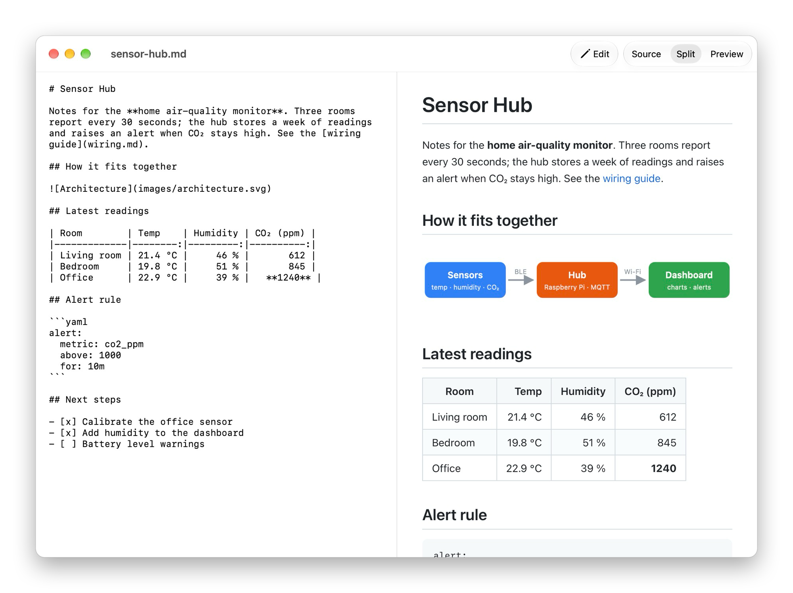
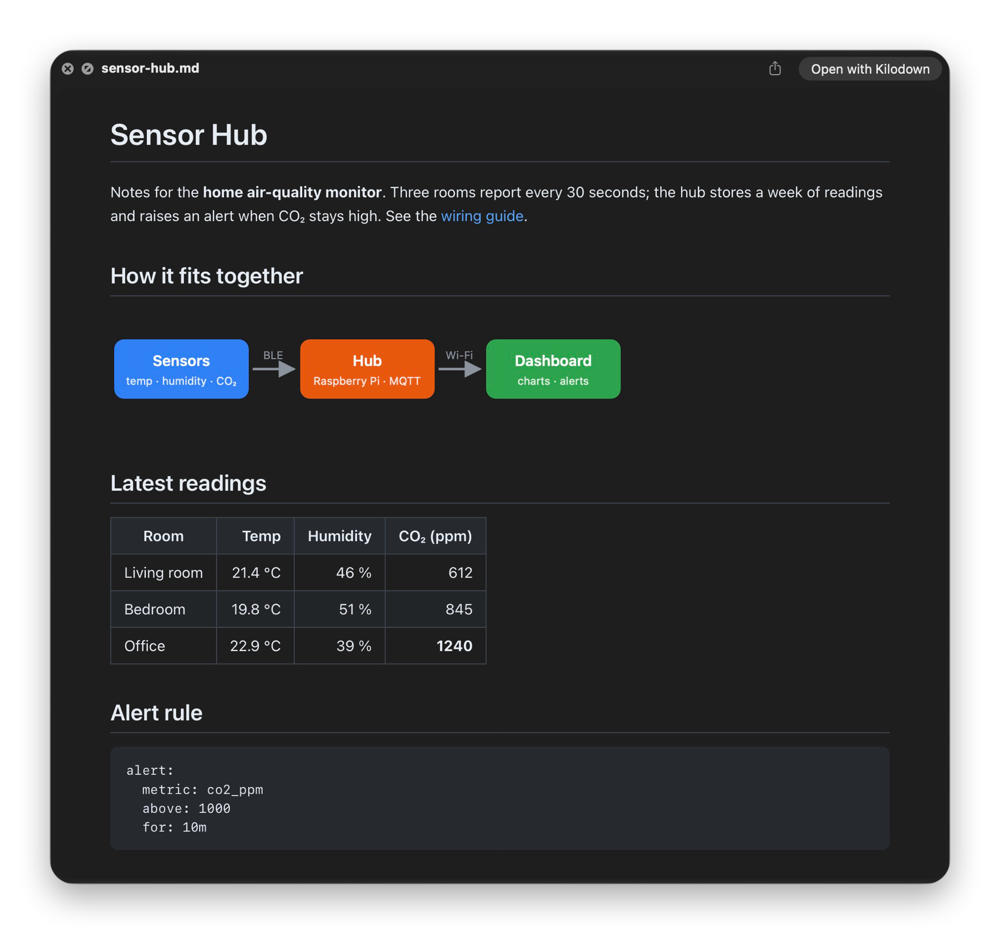

<p align="center">
  
</p>

<h1 align="center">Kilodown</h1>

<p align="center">
  A tiny native Markdown viewer and editor for macOS, with a Finder Quick Look preview.<br>
  The whole app is about 1 MB.
</p>



Press Space on a Markdown file in Finder to see it rendered, images included:

<p align="center">
  
</p>

## What it does

- **Three views:** original text, rendered, or both side by side. Switch with the toolbar or ⌘1 / ⌘2 / ⌘3.
- **Quick Look:** select a `.md` file in Finder and press Space to see it rendered.
- **Local images just work:** images referenced by relative path, absolute path, `~` path or `file://` URL are shown inline, in the app and in Quick Look.
- **Basic editing:** files open read-only. Click **Edit** (⇧⌘E) to type, with a live preview, and save with ⌘S.
- **Live reload:** the window updates when the file changes on disk. If you have unsaved edits, it asks before replacing them.
- **GitHub-flavoured Markdown:** tables, task lists, strikethrough, fenced code, heading anchors, YAML front matter.
- **Light and dark mode**, following the system.

It is deliberately small: no syntax highlighting, no formatting toolbar, no plugins.

## Install

Requires macOS 13 or later. Runs on Apple Silicon and Intel.

### Option 1: build it yourself (recommended)

This needs only Apple's free Command Line Tools (`xcode-select --install`), not Xcode. An app you build on your own Mac opens without any security warning.

```bash
git clone https://github.com/VladUZH/kilodown.git
cd kilodown
./build.sh install
```

This builds the app, copies it to `/Applications` and registers the Quick Look extension.

### Option 2: download the app

Download `Kilodown-<version>.zip` from the [Releases](https://github.com/VladUZH/kilodown/releases) page, unzip it and move `Kilodown.app` to `/Applications`.

**The download is not notarized by Apple** (this is a hobby project without a paid developer account), so macOS will refuse to open it the first time. To allow it:

1. Double-click Kilodown. macOS shows a warning; click **Done**.
2. Open **System Settings → Privacy & Security**, scroll down, and click **Open Anyway** next to the Kilodown message.

Or, in Terminal:

```bash
xattr -dr com.apple.quarantine /Applications/Kilodown.app
```

Open the app once so macOS registers the Quick Look extension.

## Using it

- **Open a file:** File → Open, drag a file onto the Dock icon, or right-click a file in Finder → Open With → Kilodown.
- **Make it the default for `.md` files:** select a Markdown file in Finder → File → Get Info → Open with → Kilodown → Change All.
- **Quick Look not showing rendered Markdown?** Check **System Settings → General → Login Items & Extensions → Quick Look** and make sure Kilodown is enabled. Another installed Markdown Quick Look plugin can also take precedence.

## Privacy and permissions

Kilodown makes no network requests of its own and collects nothing. JavaScript in the rendered preview is disabled. Remote images (`http://…`) referenced by a document are fetched by the preview, as in any Markdown viewer.

The Quick Look extension is sandboxed, with read-only access to the file system. It needs this to show images that live in folders next to (or elsewhere from) the Markdown file being previewed. It cannot write anything.

Files are saved as UTF-8.

## How it's built

Plain Swift with AppKit and WebKit, compiled by a single shell script — there is no Xcode project.

| Path | What it is |
|---|---|
| `Sources/App` | The viewer/editor window, menus and file handling |
| `Sources/QuickLook` | The Quick Look preview extension |
| `Sources/Shared` | Markdown-to-HTML rendering and image inlining, used by both |
| `Resources` | Preview stylesheet and the bundled Markdown parser |
| `Support` | Info.plist files and the extension's entitlements |
| `sample` | A test document with images |
| `docs` | README images and the demo document shown in them |

Markdown is parsed by [marked](https://github.com/markedjs/marked) running in the system's JavaScriptCore.

```bash
./build.sh            # build into ./build
./build.sh install    # build and install to /Applications
./build.sh release    # build and package dist/Kilodown-<version>.zip
ARCHS=arm64 ./build.sh   # quicker single-architecture build
```

## Licence

MIT — see [LICENSE](LICENSE). Bundles marked, also MIT-licensed (see `Resources/marked-LICENSE.md`).
