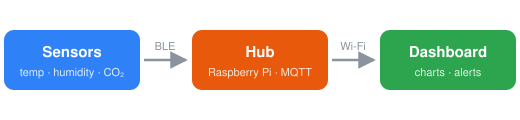

# Sensor Hub

Notes for the **home air-quality monitor**. Three rooms report every 30 seconds; the hub stores a week of readings and raises an alert when CO₂ stays high. See the [wiring guide](wiring.md).

## How it fits together



## Latest readings

| Room        | Temp    | Humidity | CO₂ (ppm) |
|-------------|--------:|---------:|----------:|
| Living room | 21.4 °C |     46 % |       612 |
| Bedroom     | 19.8 °C |     51 % |       845 |
| Office      | 22.9 °C |     39 % |   **1240** |

## Alert rule

```yaml
alert:
  metric: co2_ppm
  above: 1000
  for: 10m
```

## Next steps

- [x] Calibrate the office sensor
- [x] Add humidity to the dashboard
- [ ] Battery level warnings
