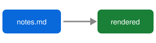

# Kilodown sample

Some **bold**, *italic*, ~~struck~~ and `inline code`, plus a [link](https://example.com)
and a jump to [the table](#a-table).

## Images

Relative path: 

Path with spaces: 

SVG via HTML tag: 

## Lists

- [x] Done item
- [ ] Open item
1. First
2. Second

> A blockquote.

```swift
let greeting = "Hello <world> & friends"
```

## A table

| Mode    | Shows            |
|---------|------------------|
| Source  | original text    |
| Preview | rendered version |
